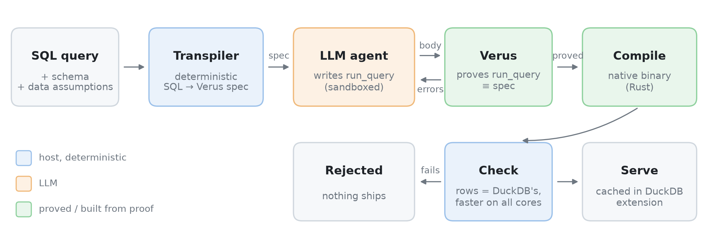

# Lemma: Verified LLM Synthesis of Query Executors

Author: TODO · Affiliation: TODO · Email: TODO

<!-- Mirror of the Claude doc 'Lemma: Verified LLM Synthesis of Query Executors' (rev 515): the Desktop draft verbatim + Emil's edits (abstract, Future-work ablations and paragraph) + the pipeline figure. Claude's proposals live in lemma_paper_proposed.md. -->

Draft for VLDB (PVLDB template), moved here from LEMMA_PAPER_111026.tex to write and add figures; LaTeX comes back at the end.

## Abstract

General-purpose OLAP engines pay for their generality through interpretation, generic operators, and layers of abstraction. Recent systems show that LLM-synthesized, per-query executors can be far faster, but their correctness rests on tests and inspection, so a single wrong answer can go unnoticed. We present Lemma, a query engine that pairs LLM synthesis with machine-checked proof. Lemma deterministically transpiles each SQL query and its catalog schema into a formal specification in Verus, a verifier for Rust. An LLM agent then writes an optimized native executor for that query and uses Verus to prove the executor equivalent to the specification before it is compiled and served. An executor can only run once it's been verified. Verified binaries are cached and invoked from a DuckDB extension, so recurring analytical queries amortize the one-time cost of synthesis and proof. On the SEC-EDGAR and TPC-H workloads, Lemma proves [TBA]% of queries and its verified executors run [TBA]× faster than DuckDB, the strongest OLAP baseline we measure, at [TBA] median end-to-end time. To our knowledge, Lemma is the first query engine whose LLM-written executors are formally proved equivalent to the query's specification.

## Introduction

- General-purpose OLAP engines pay for generality (interpretation, operators, abstractions).
- LLM-synthesized per-query code can be much faster (CodexDB, GenDB, Bespoke OLAP) but is hard to trust.
- **Lemma:** SQL → formal `MethodSpec` → agent writes optimized `run_query` → **Verus proves** `run_query` ≡ `MethodSpec` → native binary, cached in DuckDB.
- Target: recurring analytical queries where verify+compile amortizes over many runs.

## Pipeline

Figure (pipeline): SQL → transpile `MethodSpec`/`valid_cols` → agent `run_query` → assemble → Verus verify → `verus --compile` → binary → DuckDB extension cache / invoke.

*Caption: Lemma end-to-end pipeline (Verus path).*

**Steps.**

1. **Transpile.** Deterministic SQL→Verus: columnar `Cols`, `valid_cols` (row/cell bounds), `method_spec` / `method_spec_helper`. Schema-driven (no hard-coded benchmark columns).
2. ARE WE USING TEMPLATES OR HARDCODED? WHAT DOES GENDB DO?
3. **Agent.** Writes only the `run_query` body (optimized loop / agg). Host injects signature + `requires valid_cols` + `ensures` ≡ `method_spec`. Agent must not add contracts.
4. **Assemble.** Single `.rs`: spec + proved body + trusted arith/agg helpers + `load_cols` + timing `main`.
5. **Verify.** Verus/Z3: `run_query` exec ≡ `method_spec`. Fail ⇒ reject (no ship).
6. **Compile.** `verus --compile` → native binary (no Dafny postprocessor path).
7. **Serve.** DuckDB extension caches binary; repeat queries invoke native path.

**Trust boundary (concise). TODO THIS MUST BE UPDATED AND MADE NICE**

- **Proved:** agent `run_query` ≡ `method_spec` (scalar + group-by fixtures; ghost map tied to helper in same loop as exec agg).
- **Trusted:** wrapping arith under `valid_cols`; NativeAgg-style `hashmap_*`/`agg_*`; `load_cols` I/O; some SQL-feature helpers (LIKE, certain joins/set ops) when used.
- **Trusted transpiler:** SQL ≡ `method_spec` checked empirically / tests, not proved in Verus.
- Residual gap same class as Dafny externs: malicious `external_body` can lie; agent-written proved body cannot.

**Why Verus (vs prior Dafny path).**

- One artifact: annotated Rust is both proof subject and executable (no translate + unsafe peephole pass).
- Avoids Dafny `Int`/BigInt vs bitvector timeout tradeoff and postprocessor soundness hole.
- Hot path is ordinary Rust (`HashMap`, slices) with ghost state for the proof.

## System notes

### DuckDB extension

- `SELECT lemma('SQL...')` triggers optimize / verify / compile on miss; cache hit runs native binary.
- WIP polish; research harness also runs standalone (`benchmark_verified.py`).

### Agent sandbox (extension)

- Production need: sandbox the optimizer agent (or at least its tool calls). Status as of 2026-07-21: host OpenRouter ReAct loop; tools run in Docker (`--network none` by default). Not fully "production-hardened" yet.
- we add cursor agent to generate cheaply and to avoid having to optimize our own harness. (hyo-harness could be cool with env-var supplied start command)
- Inspiration: Inspect AI tool-call sandboxing; Inspect agent bridge as a way to let users plug in their own agent CLI (idk that is for monitoring)
- Data policy modes for DuckDB tool: none / stats / full (read-only).

### SQL surface (sketch)

- Analytical subset: aggs, filters, GROUP BY/HAVING, joins, subqueries/CTEs, set ops, ORDER BY/LIMIT --- many advanced shapes still use TRUSTED helpers.
- Fixtures: SSB flat, TPC-H (e.g. Q1/Q6), plus basic-SQL holdouts.

## Related Work

**LLM-synthesized query engines.**

- **CodexDB** [Trummer2022CodexDB]: LLM synthesizes per-query processing code from SQL (+ NL instructions); correctness via tests / execution, not formal proof vs a MethodSpec.
- **GPT-DB** [Trummer2023GPTDB]: follow-on demo; customizable GPT-generated SQL processing code.
- **GenDB** [Lao2026GenDB]: multi-agent instance-optimized C++ per query (workload / storage / plan / codegen / optimize); strong speedups vs DuckDB/Umbra; correctness mainly empirical / inspection.
- **Bespoke OLAP** [Wehrstein2026Bespoke]: full workload-specific C++ engine (storage + executors) with iterative perf feedback; validates vs DuckDB, not formal refinement.

**Classical query compilation (not LLM).**

- **HIQUE** [Krikellas2010HIQUE]: template-based holistic per-query C codegen.
- **HyPer** [Neumann2011Hyper] / adaptive execution [Kohn2018Adaptive]: data-centric LLVM compilation; interpret↔compile switching.
- **LegoBase** [Klonatos2014LegoBase]: generative programming / staging; Scala→specialized C.
- **Umbra** [Kersten2021UmbraFlyingStart]: fast compile (Flying Start) + optimizing LLVM path.
- **NoisePage / Peloton line** [Menon2017Relaxed, Menon2020Permutable]: relaxed operator fusion; permutable compiled queries without full recompile.
- **DBToaster** [Ahmad2012DBToaster], **Tupleware** [Crotty2015Tupleware], **Weld** [Palkar2018Weld]: specialized / IR-based codegen lineages (cite selectively).

**Formal SQL semantics & verified query compilers. TODO PRUNE, NOT SO INTERESTEING**

- **HoTTSQL** [Chu2017HoTTSQL]: mechanized denotational SQL semantics (Coq); prove rewrite rules.
- **Cosette** [Chu2017Cosette]: automated SQL equivalence prover (proof or counterexample).
- **SQL_Coq / SQL algebra** [Benzaken2019SQLCoq]: Coq semantics for realistic SQL + algebra equivalence.
- **Physical algebra / QEP layer** [Benzaken2018Physical]: Coq formalization of low-level RDBMS operators / physical plans.
- **Q\*cert** [Auerbach2017Qcert]: Coq platform for verified query compilation (NRA^e, multi-target).
- **DBCert** [Benzaken2022DBCert]: verified SQL_Coq → Imp (then JS); correct-by-construction compiler, *not* LLM-written hot paths.
- Contrast w/ Lemma: those systems verify a *fixed* compiler or rewrite; Lemma verifies an *LLM-written* executor against a transpiled MethodSpec.

**LLM + machine-checked code (general, not DB-specific).**

- **AlphaVerus** [Aggarwal2025AlphaVerus]: LLM→verified Verus via translation + verifier-guided tree search ("Treefinement").
- **Vericoding benchmarks** [Dougherty2025Vericoding]: large Dafny/Verus/Lean specs for LLM verified synthesis eval.
- Related: Formal Disco / verified-program datasets; DafnyBench-style eval --- cite if space.

**Adjacent LLM×DB (not executor synthesis).**

- **SQLBarber** [Lao2025SQLBarber]: LLM generates customized SQL *workloads* / templates (benchmarking), not query executors.
- Text-to-SQL / NL→SQL systems: large literature; orthogonal (query *text*, not verified runtime).

**Verification substrate.**

- **Verus** [Lattuada2023Verus]: SMT verification for Rust; Lemma's proof target.
- **Dafny** [Leino2010Dafny]: prior Lemma path; same agent-vs-spec idea, heavier codegen/postprocess story.

**Positioning (one line).**

- Lemma ≈ GenDB/CodexDB-style synthesis *plus* DBCert/Cosette-style machine-checked guarantees, scoped to `run_query` ≡ MethodSpec before ship.

## Evaluation

- Baselines: DuckDB (1-thread / MT), bare hand-written Rust, Lemma verified binary (both the standard extern/trusted performant one and the slow pure verified one), lemma-as-a-duckdb-extension
- Various metrics i guess, focus on the one that GenDB also used (afaik not complete cold start, ask IT)
- Workloads: SSB flat, TPC-H SF1; same custom dataset as gendb 4.2. in general same data as gendb
- tune parameters, e.g. agent used, time used for opitmization
- Report: latency, verify+compile time, token and/or $ if agent loop used.
- maybe we can get an estimate on cash savings for a use-case if we have that data (ask IT)
- ablation: remove TRUSTEDs from verus

### Holdout microbenchmark (agent-style kernels)

**Snapshot.** Measured `2026-07-21T22:38:52Z` (UTC); holdout artifact commit `dcc9d59`. Fair protocol: both sides start from *already loaded* in-memory columns / DuckDB tables; 3 warmups then median of 5 timed query-only runs. Lemma kernels written as a perfect agent would (zone maps at ingest, dict codes at ingest, in-place hash probe, dense small-card buckets); query predicates / join build+probe / aggs stay on the clock.

**Hardware (this machine).** AMD Ryzen AI 5 330 (8 logical CPUs, SMT), ~7.8 GiB RAM, Linux WSL2. MT modes: `RAYON_NUM_THREADS=8`, DuckDB `PRAGMA threads=8`.

**Datasets (on disk under holdout export; no extra cloud download).**

- Holdout working set ≈ **364 MB** under `verus/research_loop/holdout/data/`: synthetic `scan_skew` 500k / 1M; Zipf join 200k×50k; EDGAR-like `str_filter` 100k; TPC-H SF1 *slices* (200k and 1M lineitem + matching orders); SSB flat 500k row slice from local `ssb-dbgen/lineorder_flat.tbl`.
- Source TPC-H SF1 full tables also present locally (≈ 967 MB under `data/tpch-sf1/`) used only to cut slices.

**Queries H1--H25.** Diverse shapes: selective zone-pruned scans, small-card group-by, Zipf joins (+ multiplicity), string/dict filters, TPC-H Q1/Q3/Q6-like literals on slices, SSB Q1.1-ish, large-card mod-1000 group-by. Baselines: Lemma ST/MT, bare Rust ST, DuckDB 1T/MT. Ratios <1 mean Lemma wins.

*Table: Holdout H1--H25 hot-loop latency (μs). Ratios = Lemma / other.*

| Q | L_st | L_mt | bare | D_1t | D_mt | L/D_1t | L_mt/D_mt |
| --- | ---: | ---: | ---: | ---: | ---: | ---: | ---: |
| H1 | 13 | 956 | 120 | 461 | 1513 | 0.03 | 0.63 |
| H2 | 64 | 64 | 144 | 1689 | 2110 | 0.04 | 0.03 |
| H3 | 1698 | 1106 | 1249 | 79716 | 62558 | 0.02 | 0.02 |
| H4 | 125 | 307 | 621 | 1751 | 2830 | 0.07 | 0.11 |
| H5 | 1034 | 1626 | 682 | 1448 | 1894 | 0.71 | 0.86 |
| H6 | 621 | 1516 | 2779 | 1737 | 3270 | 0.36 | 0.46 |
| H7 | 248 | 264 | 4853 | 3930 | 3889 | 0.06 | 0.07 |
| H8 | 1 | 973 | 38 | 378 | 1128 | 0.00 | 0.86 |
| H9 | 13 | 1086 | 118 | 436 | 1181 | 0.03 | 0.92 |
| H10 | 27 | 1340 | 244 | 442 | 1471 | 0.06 | 0.91 |
| H11 | 1223 | 1095 | 1485 | 87953 | 65229 | 0.01 | 0.02 |
| H12 | 3992 | 4050 | 4110 | 607234 | 415966 | 0.01 | 0.01 |
| H13 | 178 | 232 | 542 | 1703 | 2943 | 0.10 | 0.08 |
| H14 | 3 | 294 | 296 | 357 | 848 | 0.01 | 0.35 |
| H15 | 3979 | 2371 | 3205 | 3922 | 2612 | 1.01 | 0.91 |
| H16 | 1204 | 1160 | 25008 | 17662 | 5609 | 0.07 | 0.21 |
| H17 | 3563 | 2918 | 18925 | 6105 | 5001 | 0.58 | 0.58 |
| H18 | 1264 | 1122 | 6912 | 8457 | 3203 | 0.15 | 0.35 |
| H19 | 384 | 799 | 358 | 857 | 1362 | 0.45 | 0.59 |
| H20 | 386 | 579 | 1188 | 2883 | 2729 | 0.13 | 0.21 |
| H21 | 504 | 2313 | 388 | 2815 | 2995 | 0.18 | 0.77 |
| H22 | 1811 | 1963 | 3143 | 10470 | 8908 | 0.17 | 0.22 |
| H23 | 674 | 2010 | 580 | 1828 | 1657 | 0.37 | 1.21 |
| H24 | 122 | 125 | 123 | 3792 | 6972 | 0.03 | 0.02 |
| H25 | 5522 | 2234 | 6181 | 11897 | 5092 | 0.46 | 0.44 |

**Takeaways (this snapshot).** Lemma ST ≤ DuckDB 1T on 24/25 queries (H15 ≈ tie). Wins concentrate on zone-pruned scans, dict-coded filters, small-card group-by, and Zipf joins; MT helps when work is large enough (e.g. H15/H17/H25) and hurts tiny kernels. Scale-up gaps (partitioned join build, vectorized scans, spill hash, DuckDB-backed columnar load) are tracked as flagged primitives / `verus/db_extension` experiments---not claimed solved by this table.

- Additional baselines still planned: full Verus-proved binaries (not only agent-primitive holdout kernels), verify+compile amortization, cache hits.
- Larger GCP / SF-scale runs deferred; protocol above is the intended fair compare.

## Future Work

1. Shrink TRUSTED surface: extend Verus coverage so low-level perf ops need fewer `external_body` externs.
2. Hardware-aware optimization: give agent HW info; needs verification support for HW-specific objects/params.
3. Stronger optimizing harness / "RSI"-style self-improvement loop (cite recent RSI harness papers --- TODO).
4. Distributed executors: interesting, but verification challenges multiply (networks, faults, consistency).
5. Figure out how to ideally integrate the agent with an existing DB or whether that is a good idea. E.g. with DuckDB, the agent could just run parallel as a separate db with its own storgae, it could read duckdb storage (out of memory), it could use duckdb chunk api, it could use higher level api.
6. Improve extension sandbox; optional Inspect-style pluggable agent CLI bridge.

Ablation studies:

- giving pre-made recipes
- adding float-trusteds
- removing/adding trusteds
    - Most recently (11 oct) we are using vstd trusteds
- weaker/stronger model
- use "imperative", not "declarative" specs

It is unclear where the current system is superior to duckdb. A hot run is faster than DuckDB, but loading in data and running it is (supposedly) not. The current format is also (supposedly) not as good as DuckDB's or that of other trad. DBs, because it e.g. does not paginate or compress. A plan for making a system that is actually competitive in the real world would be to make it operate on the data structure of an established DB. This would also allow for running it generatively or with trad. DB engine, depending on current need.

## Acknowledgements

TODO.

## References

- [Trummer2022CodexDB] Immanuel Trummer. CodexDB: Synthesizing Code for Query Processing from Natural Language Instructions using GPT-3 Codex. *PVLDB*, 15(11):2921--2928, 2022.
- [Trummer2023GPTDB] Immanuel Trummer. Demonstrating GPT-DB: Generating Query-Specific and Customizable Code for SQL Processing with GPT-4. *PVLDB*, 16(12), 2023.
- [Lao2026GenDB] Jiale Lao and Immanuel Trummer. GenDB: The Next Generation of Query Processing -- Synthesized, Not Engineered. arXiv:2603.02081, 2026.
- [Wehrstein2026Bespoke] Johannes Wehrstein, Timo Eckmann, Matthias Jasny, and Carsten Binnig. Bespoke OLAP: Synthesizing Workload-Specific One-size-fits-one Database Engines. arXiv:2603.02001, 2026.
- [Krikellas2010HIQUE] Konstantinos Krikellas, Stratis D. Viglas, and Marcelo Cintra. Generating Code for Holistic Query Evaluation. In *ICDE*, 2010.
- [Neumann2011Hyper] Thomas Neumann. Efficiently Compiling Efficient Query Plans for Modern Hardware. *PVLDB*, 4(9):539--550, 2011.
- [Kohn2018Adaptive] André Kohn, Viktor Leis, and Thomas Neumann. Adaptive Execution of Compiled Queries. In *ICDE*, 2018.
- [Klonatos2014LegoBase] Yannis Klonatos, Christoph Koch, Tiark Rompf, and Hassan Chafi. Building Efficient Query Engines in a High-Level Language. *PVLDB*, 7(10):853--864, 2014.
- [Kersten2021UmbraFlyingStart] Timo Kersten, Viktor Leis, and Thomas Neumann. Tidy Tuples and Flying Start: Fast Compilation and Fast Execution of Relational Queries in Umbra. *VLDB J.*, 2021.
- [Menon2017Relaxed] Prashanth Menon, Todd C. Mowry, and Andrew Pavlo. Relaxed Operator Fusion for In-Memory Databases: Making Compilation, Vectorization, and Prefetching Work Together At Last. *PVLDB*, 11(1):1--13, 2017.
- [Menon2020Permutable] Prashanth Menon, Amadou Ngom, Lin Ma, Todd C. Mowry, and Andrew Pavlo. Permutable Compiled Queries: Dynamically Adapting Compiled Queries without Recompiling. *PVLDB*, 14(2):101--113, 2020.
- [Ahmad2012DBToaster] Yanif Ahmad, Oliver Kennedy, Christoph Koch, and Milos Nikolic. DBToaster: Higher-order Delta Processing for Dynamic, Frequently Fresh Views. *PVLDB*, 5(10):968--979, 2012. (confirm exact citation if needed)
- [Crotty2015Tupleware] Andrew Crotty, Alex Galakatos, Kayhan Dursun, Tim Kraska, Carsten Binnig, Ugur Cetintemel, and Stan Zdonik. An Architecture for Compiling UDF-centric Workflows. *PVLDB*, 8(12):1466--1477, 2015. (Tupleware lineage; confirm title/pages)
- [Palkar2018Weld] Shoumik Palkar, James Thomas, Deepak Narayanan, Pratiksha Thaker, Rahul Palamuttam, Parimajan Negi, Anil Shanbhag, Malte Schwarzkopf, Holger Pirk, Saman Amarasinghe, Samuel Madden, and Matei Zaharia. Evaluating End-to-End Optimization for Data Analytics Applications in Weld. *PVLDB*, 11(9):1002--1015, 2018.
- [Chu2017HoTTSQL] Shumo Chu, Konstantin Weitz, Alvin Cheung, and Dan Suciu. HoTTSQL: Proving Query Rewrites with Univalent SQL Semantics. In *PLDI*, 2017.
- [Chu2017Cosette] Shumo Chu, Chenglong Wang, Konstantin Weitz, and Alvin Cheung. Cosette: An Automated Prover for SQL. In *CIDR*, 2017.
- [Benzaken2019SQLCoq] Véronique Benzaken and Évelyne Contejean. A Coq Mechanised Formal Semantics for Realistic SQL Queries: Formally Reconciling SQL and Relational Algebra. In *CPP*, 2019. (confirm venue (CPP / related))
- [Benzaken2018Physical] Véronique Benzaken, Évelyne Contejean, Chantal Keller, and Eunice Martins. A Coq Formalisation of SQL's Execution Engines. (ITP / related --- polish venue) 2018.
- [Auerbach2017Qcert] Joshua S. Auerbach, Martin Hirzel, Louis Mandel, Avraham Shinnar, and Jérôme Siméon. Q\*cert: A Platform for Implementing and Verifying Query Compilers. In *SIGMOD* (demo), 2017.
- [Benzaken2022DBCert] Véronique Benzaken, Évelyne Contejean, Mohammed Houssem Hachmaoui, Chantal Keller, Louis Mandel, Avraham Shinnar, and Jérôme Siméon. Translating Canonical SQL to Imperative Code in Coq. *Proc. ACM Program. Lang.*, 6(OOPSLA1), 2022.
- [Aggarwal2025AlphaVerus] Pranjal Aggarwal, Bryan Parno, and Sean Welleck. AlphaVerus: Bootstrapping Formally Verified Code Generation through Self-Improving Translation and Treefinement. In *ICML*, 2025.
- [Dougherty2025Vericoding] Sergiu Bursuc, Theodore Ehrenborg, Shaowei Lin, Lacramioara Astefanoaei, Ionel Emilian Chiosa, Jure Kukovec, Alok Singh, Oliver Butterley, Adem Bizid, Quinn Dougherty, Miranda Zhao, Max Tan, and Max Tegmark. A Benchmark for Vericoding: Formally Verified Program Synthesis. arXiv:2509.22908, 2025.
- [Lao2025SQLBarber] Jiale Lao and Immanuel Trummer. SQLBarber: A System Leveraging Large Language Models to Generate Customized and Realistic SQL Workloads. arXiv:2507.06192, 2025.
- [Lattuada2023Verus] Andrea Lattuada, Travis Hance, Chanhee Cho, Matthias Brun, Isitha Subasinghe, Yi Zhou, Jon Howell, Bryan Parno, and Chris Hawblitzel. Verus: Verifying Rust Programs using Linear Ghost Types. *Proc. ACM Program. Lang.*, 7(OOPSLA1), 2023.
- [Leino2010Dafny] K. Rustan M. Leino. Dafny: An Automatic Program Verifier for Functional Correctness. In *LPAR*, 2010.
