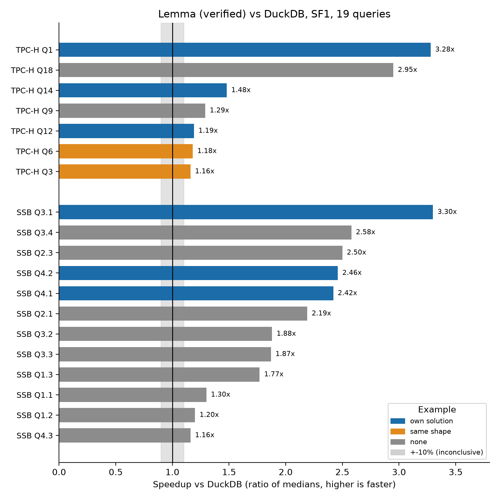

# Lemma: Verified LLM Synthesis of Query Executors

Author: TODO · Affiliation: TODO · Email: TODO

<!-- Mirror of the Claude doc 'Lemma: Verified LLM Synthesis of Query Executors' (rev 518): Claude's proposals applied by Emil's request, Emil's edits kept, figures from the figures chat. -->

Draft for VLDB (PVLDB template), moved here from LEMMA_PAPER_111026.tex to write and add figures; LaTeX comes back at the end.

## Abstract

General-purpose OLAP engines pay for their generality through interpretation, generic operators, and layers of abstraction. Recent systems show that LLM-synthesized, per-query executors can be far faster, but their correctness rests on tests and inspection, so a single wrong answer can go unnoticed. We present Lemma, a query engine that pairs LLM synthesis with machine-checked proof. Lemma deterministically transpiles each SQL query and its catalog schema into a formal specification in Verus, a verifier for Rust. An LLM agent then writes an optimized native executor for that query and uses Verus to prove the executor equivalent to the specification before it is compiled and served. An executor can only run once it's been verified. Verified binaries are cached and invoked from a DuckDB extension, so recurring analytical queries amortize the one-time cost of synthesis and proof. On TPC-H and the Star Schema Benchmark, Lemma proves [TBA]% of the queries it accepts, and its verified executors run [TBA]× faster than all-core DuckDB on hot runs. To our knowledge, Lemma is the first query engine whose LLM-written executors are formally proved equivalent to the query's specification.

## Introduction

- General-purpose OLAP engines pay for generality (interpretation, operators, abstractions).
- LLM-synthesized per-query code can be much faster (CodexDB, GenDB, Bespoke OLAP) but is hard to trust.
- **Lemma:** SQL → formal specification → agent writes optimized `run_query` → **Verus proves** `run_query` ≡ specification → native binary, cached in DuckDB.
- Target: recurring analytical queries where verify+compile amortizes over many runs.

## Pipeline

Figure (pipeline): SQL → transpile spec + `valid_cols` → agent `run_query` → assemble → Verus verify → `verus --compile` → binary → check rows and time vs DuckDB → DuckDB extension cache / invoke.

*Caption: Lemma end-to-end pipeline (Verus path).*

**Steps.**

1. **Transpile.** Deterministic SQL→Verus: columnar `Cols`, `valid_cols` (row, cell and key bounds from the assumption package), and a declarative specification of the result. Schema-driven (no hard-coded benchmark columns, no per-query templates).
2. **Agent.** Writes only the `run_query` body and its own helpers (proof, spec and exec functions, all verified). Host injects signature + `requires valid_cols` + `ensures` result ≡ specification. Agent must not add contracts or trusted code.
3. **Assemble.** Single `.rs`: spec + proved body + host lemmas (proved) + loader + timing `main`.
4. **Verify.** Verus/Z3: `run_query` meets the specification. Fail ⇒ reject (no ship).
5. **Compile.** `verus --compile` → native binary.
6. **Check and time.** The binary's rows are compared with DuckDB's; the speed verdict is the median of 5 interleaved rounds against DuckDB on all cores.
7. **Serve.** DuckDB extension caches binary; repeat queries invoke native path.

*Caption: A worked example. The input SQL query, and the program Verus checks, shortened with ⋮. Blue rows are the transpiler's output (spec and contract). Orange rows marked + are the agent's body of `run_query`; green text is proof annotation, erased at compile time. The whole program is in Appendix A.*

**Trust boundary.** The agent's code carries no trusted items; across the 19 programs of the frozen run, our own trusted items appear only in the 2 queries with floating point (TPC-H Q1, Q14).

| What | Status | Notes |
| --- | --- | --- |
| Agent `run_query` and helpers | Proved | No `assume`, `admit`, `external_body`; admission rejects them |
| Host helper lemmas (star join, group close, distinct, folds) | Proved | Emitted per query shape |
| Float idealization (11) + IEEE division by zero (1) | Trusted | Only for AVG and ratios |
| Data assumptions (row/value caps, unique keys, nullability) | Checked at load | Assumption package; `check.py` and `main` |
| Loader and timing `main` | Unverified Rust | Runtime asserts; row check against DuckDB |
| Transpiler (SQL ≡ spec) | Tested, not proved | Differential checks against DuckDB, adversary reviews |
| vstd, Verus, Z3, rustc | Trusted base | Thread spawn/join, Vec, Arc specs |

**Why Verus (vs prior Dafny path).**

- One artifact: annotated Rust is both proof subject and executable (no translate + unsafe peephole pass).
- Avoids Dafny `Int`/BigInt vs bitvector timeout tradeoff and postprocessor soundness hole.
- Hot path is ordinary Rust (`Vec`, slices, vstd threads) with ghost state for the proof.

## System notes

### DuckDB extension

- `SELECT lemma('SQL...')` triggers optimize / verify / compile on miss; cache hit runs native binary.
- Demo path today; the measured results come from the container launcher.

### Agent sandbox

- The agent (Claude Code) runs in Docker with no network except the model API through an allowlisted egress bridge.
- It edits only marked regions; verifies and submits through MCP tools (`run_runquery`, `verify_functions` for partial checks, `submit_runquery`).
- Examples mode: `full`, `principles` (7 technique examples on made-up tables), `none` (task, rules, tools, Verus reference docs only).
- Optional data profile: exact SQL statistics per query (row counts, selectivities, group counts), no query plan.
- Inspiration: Inspect AI tool-call sandboxing.

### SQL surface

- Supported: joins (incl. comma joins, star joins on unique keys), filters, GROUP BY/HAVING, ORDER BY/LIMIT, SUM/COUNT/MIN/MAX/AVG, COUNT DISTINCT, uncorrelated scalar subqueries, anti-joins, NULLs, DECIMAL, DATE, dictionary strings.
- Not supported: recursion, window functions, outer joins (except anti-join), set operations, string functions, correlated subqueries; 5+ table joins lightly tested.
- Workloads: TPC-H SF1 and SSB SF1.

## Related Work

**LLM-synthesized query engines.**

- **CodexDB** [Trummer2022CodexDB]: LLM synthesizes per-query processing code from SQL (+ NL instructions); correctness via tests / execution, not formal proof vs a MethodSpec.
- **GPT-DB** [Trummer2023GPTDB]: follow-on demo; customizable GPT-generated SQL processing code.
- **GenDB** [Lao2026GenDB]: multi-agent instance-optimized C++ per query (workload / storage / plan / codegen / optimize); strong speedups vs DuckDB/Umbra; correctness mainly empirical / inspection.
- **Bespoke OLAP** [Wehrstein2026Bespoke]: full workload-specific C++ engine (storage + executors) with iterative perf feedback; validates vs DuckDB, not formal refinement.

**Classical query compilation (not LLM).**

- **HIQUE** [Krikellas2010HIQUE]: template-based holistic per-query C codegen.
- **HyPer** [Neumann2011Hyper] / adaptive execution [Kohn2018Adaptive]: data-centric LLVM compilation; interpret↔compile switching.
- **LegoBase** [Klonatos2014LegoBase]: generative programming / staging; Scala→specialized C.
- **Umbra** [Kersten2021UmbraFlyingStart]: fast compile (Flying Start) + optimizing LLVM path.
- **NoisePage / Peloton line** [Menon2017Relaxed, Menon2020Permutable]: relaxed operator fusion; permutable compiled queries without full recompile.
- **DBToaster** [Ahmad2012DBToaster], **Tupleware** [Crotty2015Tupleware], **Weld** [Palkar2018Weld]: specialized / IR-based codegen lineages (cite selectively).

**Formal SQL semantics & verified query compilers. TODO PRUNE, NOT SO INTERESTEING**

- **HoTTSQL** [Chu2017HoTTSQL]: mechanized denotational SQL semantics (Coq); prove rewrite rules.
- **Cosette** [Chu2017Cosette]: automated SQL equivalence prover (proof or counterexample).
- **SQL_Coq / SQL algebra** [Benzaken2019SQLCoq]: Coq semantics for realistic SQL + algebra equivalence.
- **Physical algebra / QEP layer** [Benzaken2018Physical]: Coq formalization of low-level RDBMS operators / physical plans.
- **Q\*cert** [Auerbach2017Qcert]: Coq platform for verified query compilation (NRA^e, multi-target).
- **DBCert** [Benzaken2022DBCert]: verified SQL_Coq → Imp (then JS); correct-by-construction compiler, *not* LLM-written hot paths.
- Contrast w/ Lemma: those systems verify a *fixed* compiler or rewrite; Lemma verifies an *LLM-written* executor against a transpiled MethodSpec.

**LLM + machine-checked code (general, not DB-specific).**

- **AlphaVerus** [Aggarwal2025AlphaVerus]: LLM→verified Verus via translation + verifier-guided tree search ("Treefinement").
- **Vericoding benchmarks** [Dougherty2025Vericoding]: large Dafny/Verus/Lean specs for LLM verified synthesis eval.
- Related: Formal Disco / verified-program datasets; DafnyBench-style eval --- cite if space.

**Adjacent LLM×DB (not executor synthesis).**

- **SQLBarber** [Lao2025SQLBarber]: LLM generates customized SQL *workloads* / templates (benchmarking), not query executors.
- Text-to-SQL / NL→SQL systems: large literature; orthogonal (query *text*, not verified runtime).

**Verification substrate.**

- **Verus** [Lattuada2023Verus]: SMT verification for Rust; Lemma's proof target.
- **Dafny** [Leino2010Dafny]: prior Lemma path; same agent-vs-spec idea, heavier codegen/postprocess story.

**Positioning (one line).**

- Lemma ≈ GenDB/CodexDB-style synthesis *plus* DBCert/Cosette-style machine-checked guarantees, scoped to `run_query` ≡ MethodSpec before ship.

## Evaluation

In the frozen run (commit 75f4303), all 19 attempted queries proved, matched DuckDB's rows and beat all-core DuckDB: median 2.04× on SSB (12 queries) and 1.29× on TPC-H (7 queries).

**Setup.** Claude Sonnet 5.5 in the container, 25 min per query, full worked examples, dictionary strings, star-join specs. Official verdict: median of 5 interleaved rounds against DuckDB 1.5.4 on all 8 threads, 8 GB memory limit. AMD Ryzen AI 5 330 (4 cores / 8 threads), 14 GB RAM. SF1.

**Caveats.**

- 6 of 19 queries had their own solution mounted as an example; the agent copied or adapted examples in 15 of 19. Only TPC-H Q18 was clearly solved independently. Runs without examples (`none` mode) are in progress.
- Times are milliseconds at SF1; only ratios to DuckDB on the same machine are meaningful, not GenDB's absolute times (SF10, 32 cores, 384 GB).
- Data loading is excluded from the timed runs, as in GenDB's hot runs.
- Not attempted: 15 of 22 TPC-H queries; SSB Q2.2 does not transpile (BETWEEN on strings).

Still to add: proof and agent time per query, cost, the `none`/`principles` runs. The H1--H25 holdout table (hand-written kernels, not proved) is dropped.

## Future Work

1. Shrink TRUSTED surface: exact AVG and division as integer fractions (removes the 12 float items for DECIMAL data); verify the loader's runtime checks.
2. Hardware-aware optimization: the agent already gets `lscpu` and a data profile; needs verification support for HW-specific objects/params.
3. Stronger optimizing harness / "RSI"-style self-improvement loop (cite recent RSI harness papers --- TODO).
4. Distributed executors: interesting, but verification challenges multiply (networks, faults, consistency).
5. Figure out how to ideally integrate the agent with an existing DB or whether that is a good idea. E.g. with DuckDB, the agent could just run parallel as a separate db with its own storgae, it could read duckdb storage (out of memory), it could use duckdb chunk api, it could use higher level api.
6. Improve extension sandbox; optional Inspect-style pluggable agent CLI bridge.

Ablation studies:

- giving pre-made recipes
- adding float-trusteds
- removing/adding trusteds
    - Most recently (11 oct) we are using vstd trusteds
- weaker/stronger model
- use "imperative", not "declarative" specs

It is unclear where the current system is superior to duckdb. A hot run is faster than DuckDB, but loading in data and running it is (supposedly) not. The current format is also (supposedly) not as good as DuckDB's or that of other trad. DBs, because it e.g. does not paginate or compress. A plan for making a system that is actually competitive in the real world would be to make it operate on the data structure of an established DB. This would also allow for running it generatively or with trad. DB engine, depending on current need.

## Acknowledgements

TODO.

## References

- [Trummer2022CodexDB] Immanuel Trummer. CodexDB: Synthesizing Code for Query Processing from Natural Language Instructions using GPT-3 Codex. *PVLDB*, 15(11):2921--2928, 2022.
- [Trummer2023GPTDB] Immanuel Trummer. Demonstrating GPT-DB: Generating Query-Specific and Customizable Code for SQL Processing with GPT-4. *PVLDB*, 16(12), 2023.
- [Lao2026GenDB] Jiale Lao and Immanuel Trummer. GenDB: The Next Generation of Query Processing -- Synthesized, Not Engineered. arXiv:2603.02081, 2026.
- [Wehrstein2026Bespoke] Johannes Wehrstein, Timo Eckmann, Matthias Jasny, and Carsten Binnig. Bespoke OLAP: Synthesizing Workload-Specific One-size-fits-one Database Engines. arXiv:2603.02001, 2026.
- [Krikellas2010HIQUE] Konstantinos Krikellas, Stratis D. Viglas, and Marcelo Cintra. Generating Code for Holistic Query Evaluation. In *ICDE*, 2010.
- [Neumann2011Hyper] Thomas Neumann. Efficiently Compiling Efficient Query Plans for Modern Hardware. *PVLDB*, 4(9):539--550, 2011.
- [Kohn2018Adaptive] André Kohn, Viktor Leis, and Thomas Neumann. Adaptive Execution of Compiled Queries. In *ICDE*, 2018.
- [Klonatos2014LegoBase] Yannis Klonatos, Christoph Koch, Tiark Rompf, and Hassan Chafi. Building Efficient Query Engines in a High-Level Language. *PVLDB*, 7(10):853--864, 2014.
- [Kersten2021UmbraFlyingStart] Timo Kersten, Viktor Leis, and Thomas Neumann. Tidy Tuples and Flying Start: Fast Compilation and Fast Execution of Relational Queries in Umbra. *VLDB J.*, 2021.
- [Menon2017Relaxed] Prashanth Menon, Todd C. Mowry, and Andrew Pavlo. Relaxed Operator Fusion for In-Memory Databases: Making Compilation, Vectorization, and Prefetching Work Together At Last. *PVLDB*, 11(1):1--13, 2017.
- [Menon2020Permutable] Prashanth Menon, Amadou Ngom, Lin Ma, Todd C. Mowry, and Andrew Pavlo. Permutable Compiled Queries: Dynamically Adapting Compiled Queries without Recompiling. *PVLDB*, 14(2):101--113, 2020.
- [Ahmad2012DBToaster] Yanif Ahmad, Oliver Kennedy, Christoph Koch, and Milos Nikolic. DBToaster: Higher-order Delta Processing for Dynamic, Frequently Fresh Views. *PVLDB*, 5(10):968--979, 2012. (confirm exact citation if needed)
- [Crotty2015Tupleware] Andrew Crotty, Alex Galakatos, Kayhan Dursun, Tim Kraska, Carsten Binnig, Ugur Cetintemel, and Stan Zdonik. An Architecture for Compiling UDF-centric Workflows. *PVLDB*, 8(12):1466--1477, 2015. (Tupleware lineage; confirm title/pages)
- [Palkar2018Weld] Shoumik Palkar, James Thomas, Deepak Narayanan, Pratiksha Thaker, Rahul Palamuttam, Parimajan Negi, Anil Shanbhag, Malte Schwarzkopf, Holger Pirk, Saman Amarasinghe, Samuel Madden, and Matei Zaharia. Evaluating End-to-End Optimization for Data Analytics Applications in Weld. *PVLDB*, 11(9):1002--1015, 2018.
- [Chu2017HoTTSQL] Shumo Chu, Konstantin Weitz, Alvin Cheung, and Dan Suciu. HoTTSQL: Proving Query Rewrites with Univalent SQL Semantics. In *PLDI*, 2017.
- [Chu2017Cosette] Shumo Chu, Chenglong Wang, Konstantin Weitz, and Alvin Cheung. Cosette: An Automated Prover for SQL. In *CIDR*, 2017.
- [Benzaken2019SQLCoq] Véronique Benzaken and Évelyne Contejean. A Coq Mechanised Formal Semantics for Realistic SQL Queries: Formally Reconciling SQL and Relational Algebra. In *CPP*, 2019. (confirm venue (CPP / related))
- [Benzaken2018Physical] Véronique Benzaken, Évelyne Contejean, Chantal Keller, and Eunice Martins. A Coq Formalisation of SQL's Execution Engines. (ITP / related --- polish venue) 2018.
- [Auerbach2017Qcert] Joshua S. Auerbach, Martin Hirzel, Louis Mandel, Avraham Shinnar, and Jérôme Siméon. Q\*cert: A Platform for Implementing and Verifying Query Compilers. In *SIGMOD* (demo), 2017.
- [Benzaken2022DBCert] Véronique Benzaken, Évelyne Contejean, Mohammed Houssem Hachmaoui, Chantal Keller, Louis Mandel, Avraham Shinnar, and Jérôme Siméon. Translating Canonical SQL to Imperative Code in Coq. *Proc. ACM Program. Lang.*, 6(OOPSLA1), 2022.
- [Aggarwal2025AlphaVerus] Pranjal Aggarwal, Bryan Parno, and Sean Welleck. AlphaVerus: Bootstrapping Formally Verified Code Generation through Self-Improving Translation and Treefinement. In *ICML*, 2025.
- [Dougherty2025Vericoding] Sergiu Bursuc, Theodore Ehrenborg, Shaowei Lin, Lacramioara Astefanoaei, Ionel Emilian Chiosa, Jure Kukovec, Alok Singh, Oliver Butterley, Adem Bizid, Quinn Dougherty, Miranda Zhao, Max Tan, and Max Tegmark. A Benchmark for Vericoding: Formally Verified Program Synthesis. arXiv:2509.22908, 2025.
- [Lao2025SQLBarber] Jiale Lao and Immanuel Trummer. SQLBarber: A System Leveraging Large Language Models to Generate Customized and Realistic SQL Workloads. arXiv:2507.06192, 2025.
- [Lattuada2023Verus] Andrea Lattuada, Travis Hance, Chanhee Cho, Matthias Brun, Isitha Subasinghe, Yi Zhou, Jon Howell, Bryan Parno, and Chris Hawblitzel. Verus: Verifying Rust Programs using Linear Ghost Types. *Proc. ACM Program. Lang.*, 7(OOPSLA1), 2023.
- [Leino2010Dafny] K. Rustan M. Leino. Dafny: An Automatic Program Verifier for Functional Correctness. In *LPAR*, 2010.

## Appendix A: Full program for one query

*Caption: The whole program for `SELECT SUM(line) AS total FROM pre WHERE line > 5`, verbatim except the 79 `use vstd::...` import lines. Blue: transpiler output. Orange, marked +: the agent's body of `run_query`, between the `AGENT_EDIT` markers. The body is the repo example `ungrouped_sum_where.rs`, which our test suite verifies with Verus.*
