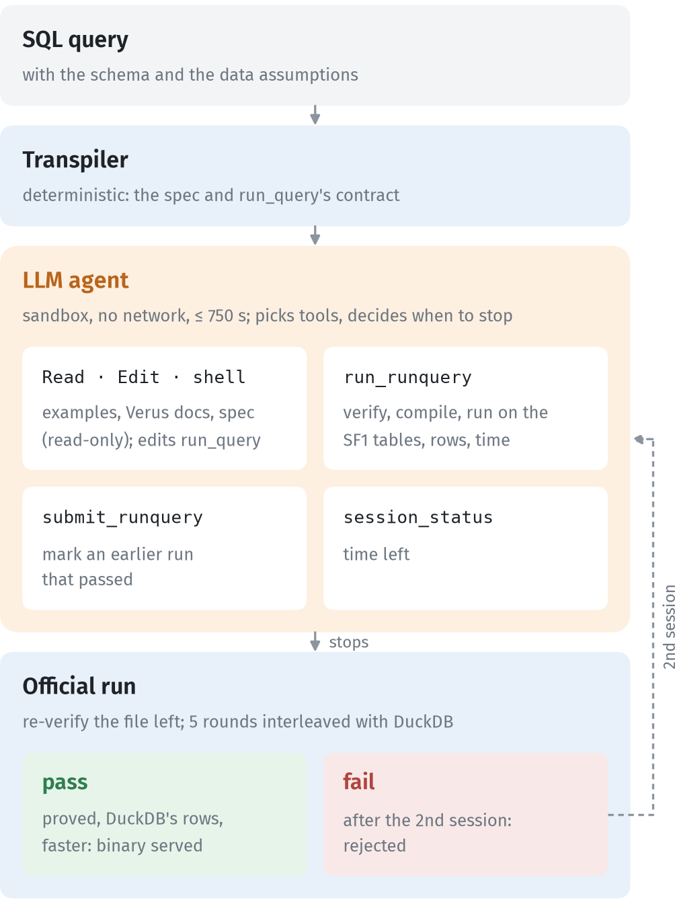
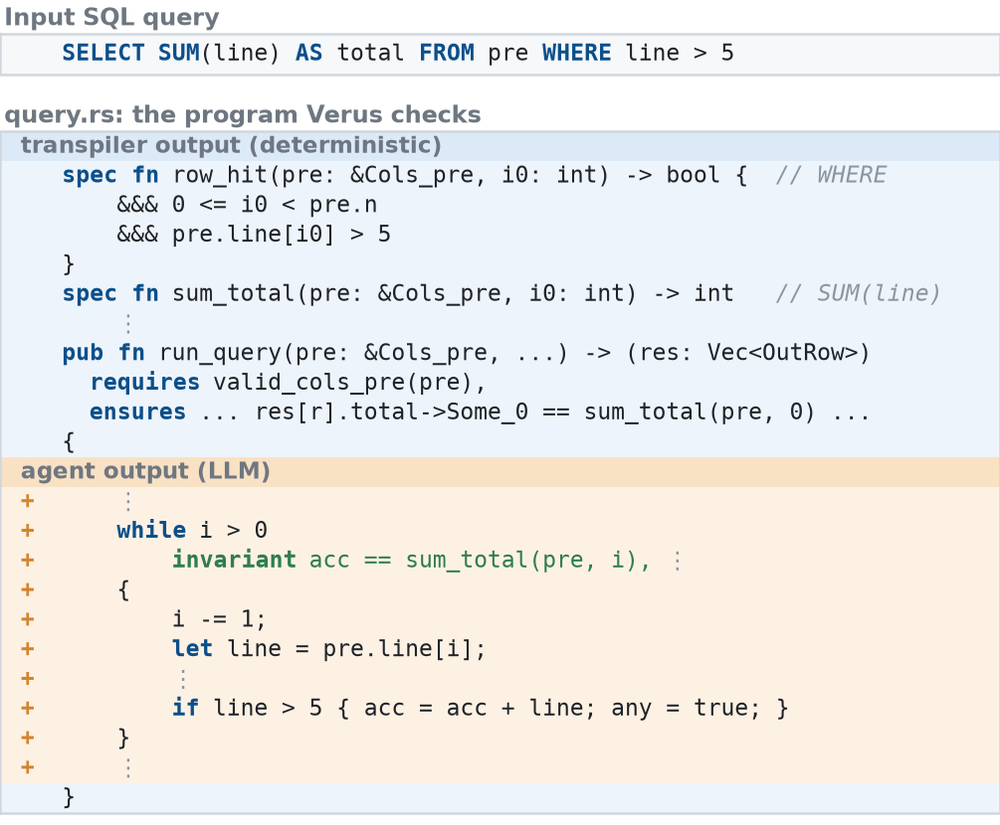
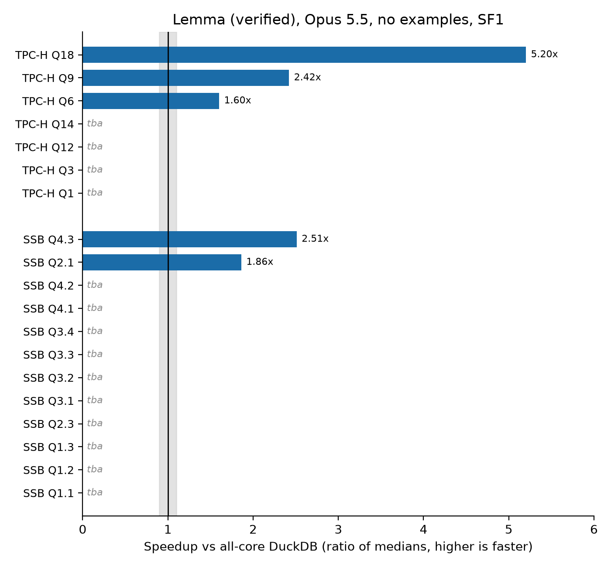

# Lemma: Verified LLM Synthesis of Query Executors

Oct 11, 2026 · @Emil

Draft for VLDB (PVLDB template), moved here from LEMMA\_PAPER\_111026.tex to write and add figures; LaTeX comes back at the end.

## Abstract

General-purpose OLAP engines pay for their generality through interpretation, generic operators, and layers of abstraction. Recent systems show that LLM-synthesized, per-query executors can be far faster, but their correctness rests on tests and inspection, so a single wrong answer can go unnoticed. We present Lemma, a query engine that pairs LLM synthesis with machine-checked proof. Lemma deterministically transpiles each SQL query and its catalog schema into a formal specification in Verus, a verifier for Rust. An LLM agent then writes an optimized native executor for that query and uses Verus to prove the executor equivalent to the specification before it is compiled and served. An executor can only run once it's been verified. Verified binaries are cached and invoked from a DuckDB extension, so recurring analytical queries amortize the one-time cost of synthesis and proof. On TPC-H and the Star Schema Benchmark, Lemma proves \[TBA\]% of the queries it accepts, and its verified executors run \[TBA\]× faster than all-core DuckDB on hot runs. To our knowledge, Lemma is the first query engine whose LLM-written executors are formally proved equivalent to the query's specification.

## Introduction

- General-purpose OLAP engines pay for generality (interpretation, operators, abstractions).
- LLM-synthesized per-query code can be much faster (CodexDB, GenDB, Bespoke OLAP) but is hard to trust.
- **Lemma:** SQL → formal specification → agent writes optimized `run_query` → **Verus proves** `run_query` ≡ specification → native binary, cached in DuckDB.
- Target: recurring analytical queries where verify+compile amortizes over many runs.

## Pipeline

Figure (pipeline): SQL → transpile spec + `valid_cols` → agent `run_query` → assemble → Verus verify → `verus --compile` → binary → check rows and time vs DuckDB → DuckDB extension cache / invoke. *Caption: Lemma end-to-end pipeline (Verus path).*



**Steps.**

1. **Transpile.** Deterministic SQL→Verus: columnar `Cols`, `valid_cols` (row, cell and key bounds from the assumption package), and a declarative specification of the result. Schema-driven (no hard-coded benchmark columns, no per-query templates).
2. **Agent.** Writes only the `run_query` body and its own helpers (proof, spec and exec functions, all verified). Host injects signature + `requires valid_cols` + `ensures` result ≡ specification. Agent must not add contracts or trusted code.
3. **Assemble.** Single `.rs`: spec + proved body + host lemmas (proved) + loader + timing `main`.
4. **Verify.** Verus/Z3: `run_query` meets the specification. Fail ⇒ reject (no ship).
5. **Compile.** `verus --compile` → native binary.
6. **Check and time.** The binary's rows are compared with DuckDB's; the speed verdict is the median of 5 interleaved rounds against DuckDB on all cores.
7. **Serve.** DuckDB extension caches binary; repeat queries invoke native path.



*Caption: A worked example. The input SQL query, and the program Verus checks, shortened with ⋮. Blue rows are the transpiler's output (spec and contract). Orange rows marked + are the agent's body of `run_query`; green text is proof annotation, erased at compile time. The whole program is in Appendix A.*

**Trust boundary.** The assembly step makes sure the agent's code runs only once it has been verified: the host refuses a body that uses assume, admit or external\_body, places the body inside the specification it emitted, and compiles only a program Verus has checked.

| What | Status | Notes |
| --- | --- | --- |
| Agent `run_query` and helpers | Proved | No `assume`, `admit`, `external_body`; admission rejects them |
| Host helper lemmas (star join, group close, distinct, folds) | Proved | Emitted per query shape |
| Float idealization (11) + IEEE division by zero (1) | Trusted | Only for AVG and ratios |
| Data assumptions (row/value caps, unique keys, nullability) | Checked at load | Assumption package; `check.py` and `main` |
| Loader and timing `main` | Unverified Rust | Runtime asserts; row check against DuckDB |
| Transpiler (SQL ≡ spec) | Tested, not proved | Differential checks against DuckDB, adversary reviews |
| vstd, Verus, Z3, rustc | Trusted base | Thread spawn/join, Vec, Arc specs |

The data assumptions come from the user's own DuckDB: a profiling tool measures row counts, value ranges, distinct counts and join sizes, proposes each cap with a margin (rounded up to a power of two), and the user approves every claim; unique keys stay proposals until the user accepts them.

## System notes

### Agent sandbox

- The agent (Claude Code) runs in Docker with no network except the model API through an allowlisted egress bridge.
- It edits only marked regions; verifies and submits through MCP tools (`run_runquery`, `verify_functions` for partial checks, `submit_runquery`).
- Examples mode: `full`, `principles` (7 technique examples on made-up tables), `none` (task, rules, tools, Verus reference docs only).
- Optional data profile: exact SQL statistics per query (row counts, selectivities, group counts), no query plan.

### SQL surface

- Supported: joins (incl. comma joins, star joins on unique keys), filters, GROUP BY/HAVING, ORDER BY/LIMIT, SUM/COUNT/MIN/MAX/AVG, COUNT DISTINCT, uncorrelated scalar subqueries, anti-joins, NULLs, DECIMAL, DATE, dictionary strings.
- Not supported: recursion, window functions, outer joins (except anti-join), set operations, string functions, correlated subqueries; 5+ table joins lightly tested.
- Workloads: TPC-H SF1 and SSB SF1.

## Evaluation

In the frozen run (commit 75f4303), all 19 attempted queries proved, matched DuckDB's rows and beat all-core DuckDB: median 2.04× on SSB (12 queries) and 1.29× on TPC-H (7 queries).



*Figure: speedup over all-core DuckDB at SF1, Claude Opus 5.5 without worked examples (Appendix F). tba = not yet run in this configuration.*

**Setup.** Claude Sonnet 5.5 in the container, 25 min per query, full worked examples, dictionary strings, star-join specs. Official verdict: hot runs, median of 5 interleaved rounds against DuckDB 1.5.4 on all 8 threads, 8 GB memory limit. AMD Ryzen AI 5 330 (4 cores / 8 threads), 14 GB RAM. SF1.

**Number formats.** Both Lemma and DuckDB represent `DECIMAL` and `DATE` values as exact integers; floating point appears only where SQL returns `DOUBLE` (`AVG` in TPC-H Q1 and the ratio in Q14), where both compute in IEEE double and our specification treats the operations as exact reals (see Trust boundary).

GenDB's times come from different hardware (SF10, 32 cores, 384 GB), so we compare only ratios to DuckDB on the same machine.

We also ran the agent without worked examples (`none` mode) and with other configurations; see Appendix D.

## Related work

**LLM-synthesized query engines.**

- **CodexDB** \[Trummer2022CodexDB\]: LLM synthesizes per-query processing code from SQL (+ NL instructions); correctness via tests / execution, not formal proof vs a MethodSpec.
- **GPT-DB** \[Trummer2023GPTDB\]: follow-on demo; customizable GPT-generated SQL processing code.
- **GenDB** \[Lao2026GenDB\]: multi-agent instance-optimized C++ per query (workload / storage / plan / codegen / optimize); strong speedups vs DuckDB/Umbra; correctness mainly empirical / inspection.
- **Bespoke OLAP** \[Wehrstein2026Bespoke\]: full workload-specific C++ engine (storage + executors) with iterative perf feedback; validates vs DuckDB, not formal refinement.

**Classical query compilation (not LLM).**

- **HIQUE** \[Krikellas2010HIQUE\]: template-based holistic per-query C codegen.
- **HyPer** \[Neumann2011Hyper\] / adaptive execution \[Kohn2018Adaptive\]: data-centric LLVM compilation; interpret↔compile switching.
- **LegoBase** \[Klonatos2014LegoBase\]: generative programming / staging; Scala→specialized C.
- **Umbra** \[Kersten2021UmbraFlyingStart\]: fast compile (Flying Start) + optimizing LLVM path.
- **NoisePage / Peloton line** \[Menon2017Relaxed, Menon2020Permutable\]: relaxed operator fusion; permutable compiled queries without full recompile.
- **DBToaster** \[Ahmad2012DBToaster\], **Tupleware** \[Crotty2015Tupleware\], **Weld** \[Palkar2018Weld\]: specialized / IR-based codegen lineages (cite selectively).

**Formal SQL semantics & verified query compilers. TODO PRUNE, NOT SO INTERESTEING**

- **HoTTSQL** \[Chu2017HoTTSQL\]: mechanized denotational SQL semantics (Coq); prove rewrite rules.
- **Cosette** \[Chu2017Cosette\]: automated SQL equivalence prover (proof or counterexample).
- **SQL\_Coq / SQL algebra** \[Benzaken2019SQLCoq\]: Coq semantics for realistic SQL + algebra equivalence.
- **Physical algebra / QEP layer** \[Benzaken2018Physical\]: Coq formalization of low-level RDBMS operators / physical plans.
- **Q\*cert** \[Auerbach2017Qcert\]: Coq platform for verified query compilation (NRA^e, multi-target).
- **DBCert** \[Benzaken2022DBCert\]: verified SQL\_Coq → Imp (then JS); correct-by-construction compiler, *not* LLM-written hot paths.
- Contrast w/ Lemma: those systems verify a *fixed* compiler or rewrite; Lemma verifies an *LLM-written* executor against a transpiled MethodSpec.

**LLM + machine-checked code (general, not DB-specific).**

- **AlphaVerus** \[Aggarwal2025AlphaVerus\]: LLM→verified Verus via translation + verifier-guided tree search ("Treefinement").
- **Vericoding benchmarks** \[Dougherty2025Vericoding\]: large Dafny/Verus/Lean specs for LLM verified synthesis eval.
- Related: Formal Disco / verified-program datasets; DafnyBench-style eval --- cite if space.

**Adjacent LLM×DB (not executor synthesis).**

- **SQLBarber** \[Lao2025SQLBarber\]: LLM generates customized SQL *workloads* / templates (benchmarking), not query executors.
- Text-to-SQL / NL→SQL systems: large literature; orthogonal (query *text*, not verified runtime).

**Verification substrate.**

- **Verus** \[Lattuada2023Verus\]: SMT verification for Rust; Lemma's proof target.
- **Dafny** \[Leino2010Dafny\]: prior Lemma path; same agent-vs-spec idea, heavier codegen/postprocess story.

**Positioning (one line).**

- Lemma ≈ GenDB/CodexDB-style synthesis *plus* DBCert/Cosette-style machine-checked guarantees, scoped to `run_query` ≡ MethodSpec before ship.

## Future work

1. Shrink TRUSTED surface: exact AVG and division as integer fractions (removes the 12 float items for DECIMAL data); verify the loader's runtime checks.
2. Stronger optimizing harness / "RSI"-style self-improvement loop (cite recent RSI harness papers --- TODO).
3. Improve extension sandbox; optional Inspect-style pluggable agent CLI bridge.

Ablation studies / feature additions:

- giving pre-made recipes
- adding float-trusteds
- removing/adding trusteds
  - Most recently (11 oct) we are using vstd trusteds
- weaker/stronger model
- use "imperative", not "declarative" specs
- on some novel set of queries: allow internet access

It is unclear where the current system is superior to duckdb. A hot run is faster than DuckDB, but loading in data and running it is (supposedly) not. The current simple load-cols-as-vectors-into-RAM format is also (arguably) not as production-ready as DuckDB's or that of other trad. DBs in different aspects, because it e.g. does not paginate or compress. A plan for making a system that is actually competitive in the real world would be to make it operate on the data structure of an established DB. This would also allow for running it generatively or with trad. DB engine, depending on current need.

## References

- &#91;Trummer2022CodexDB\] Immanuel Trummer. CodexDB: Synthesizing Code for Query Processing from Natural Language Instructions using GPT-3 Codex. *PVLDB*, 15(11):2921--2928, 2022.
- &#91;Trummer2023GPTDB\] Immanuel Trummer. Demonstrating GPT-DB: Generating Query-Specific and Customizable Code for SQL Processing with GPT-4. *PVLDB*, 16(12), 2023.
- &#91;Lao2026GenDB\] Jiale Lao and Immanuel Trummer. GenDB: The Next Generation of Query Processing -- Synthesized, Not Engineered. arXiv:2603.02081, 2026.
- &#91;Wehrstein2026Bespoke\] Johannes Wehrstein, Timo Eckmann, Matthias Jasny, and Carsten Binnig. Bespoke OLAP: Synthesizing Workload-Specific One-size-fits-one Database Engines. arXiv:2603.02001, 2026.
- &#91;Krikellas2010HIQUE\] Konstantinos Krikellas, Stratis D. Viglas, and Marcelo Cintra. Generating Code for Holistic Query Evaluation. In *ICDE*, 2010.
- &#91;Neumann2011Hyper\] Thomas Neumann. Efficiently Compiling Efficient Query Plans for Modern Hardware. *PVLDB*, 4(9):539--550, 2011.
- &#91;Kohn2018Adaptive\] André Kohn, Viktor Leis, and Thomas Neumann. Adaptive Execution of Compiled Queries. In *ICDE*, 2018.
- &#91;Klonatos2014LegoBase\] Yannis Klonatos, Christoph Koch, Tiark Rompf, and Hassan Chafi. Building Efficient Query Engines in a High-Level Language. *PVLDB*, 7(10):853--864, 2014.
- &#91;Kersten2021UmbraFlyingStart\] Timo Kersten, Viktor Leis, and Thomas Neumann. Tidy Tuples and Flying Start: Fast Compilation and Fast Execution of Relational Queries in Umbra. *VLDB J.*, 2021.
- &#91;Menon2017Relaxed\] Prashanth Menon, Todd C. Mowry, and Andrew Pavlo. Relaxed Operator Fusion for In-Memory Databases: Making Compilation, Vectorization, and Prefetching Work Together At Last. *PVLDB*, 11(1):1--13, 2017.
- &#91;Menon2020Permutable\] Prashanth Menon, Amadou Ngom, Lin Ma, Todd C. Mowry, and Andrew Pavlo. Permutable Compiled Queries: Dynamically Adapting Compiled Queries without Recompiling. *PVLDB*, 14(2):101--113, 2020.
- &#91;Ahmad2012DBToaster\] Yanif Ahmad, Oliver Kennedy, Christoph Koch, and Milos Nikolic. DBToaster: Higher-order Delta Processing for Dynamic, Frequently Fresh Views. *PVLDB*, 5(10):968--979, 2012. (confirm exact citation if needed)
- &#91;Crotty2015Tupleware\] Andrew Crotty, Alex Galakatos, Kayhan Dursun, Tim Kraska, Carsten Binnig, Ugur Cetintemel, and Stan Zdonik. An Architecture for Compiling UDF-centric Workflows. *PVLDB*, 8(12):1466--1477, 2015. (Tupleware lineage; confirm title/pages)
- &#91;Palkar2018Weld\] Shoumik Palkar, James Thomas, Deepak Narayanan, Pratiksha Thaker, Rahul Palamuttam, Parimajan Negi, Anil Shanbhag, Malte Schwarzkopf, Holger Pirk, Saman Amarasinghe, Samuel Madden, and Matei Zaharia. Evaluating End-to-End Optimization for Data Analytics Applications in Weld. *PVLDB*, 11(9):1002--1015, 2018.
- &#91;Chu2017HoTTSQL\] Shumo Chu, Konstantin Weitz, Alvin Cheung, and Dan Suciu. HoTTSQL: Proving Query Rewrites with Univalent SQL Semantics. In *PLDI*, 2017.
- &#91;Chu2017Cosette\] Shumo Chu, Chenglong Wang, Konstantin Weitz, and Alvin Cheung. Cosette: An Automated Prover for SQL. In *CIDR*, 2017.
- &#91;Benzaken2019SQLCoq\] Véronique Benzaken and Évelyne Contejean. A Coq Mechanised Formal Semantics for Realistic SQL Queries: Formally Reconciling SQL and Relational Algebra. In *CPP*, 2019. (confirm venue (CPP / related))
- &#91;Benzaken2018Physical\] Véronique Benzaken, Évelyne Contejean, Chantal Keller, and Eunice Martins. A Coq Formalisation of SQL's Execution Engines. (ITP / related --- polish venue) 2018.
- &#91;Auerbach2017Qcert\] Joshua S. Auerbach, Martin Hirzel, Louis Mandel, Avraham Shinnar, and Jérôme Siméon. Q\*cert: A Platform for Implementing and Verifying Query Compilers. In *SIGMOD* (demo), 2017.
- &#91;Benzaken2022DBCert\] Véronique Benzaken, Évelyne Contejean, Mohammed Houssem Hachmaoui, Chantal Keller, Louis Mandel, Avraham Shinnar, and Jérôme Siméon. Translating Canonical SQL to Imperative Code in Coq. *Proc. ACM Program. Lang.*, 6(OOPSLA1), 2022.
- &#91;Aggarwal2025AlphaVerus\] Pranjal Aggarwal, Bryan Parno, and Sean Welleck. AlphaVerus: Bootstrapping Formally Verified Code Generation through Self-Improving Translation and Treefinement. In *ICML*, 2025.
- &#91;Dougherty2025Vericoding\] Sergiu Bursuc, Theodore Ehrenborg, Shaowei Lin, Lacramioara Astefanoaei, Ionel Emilian Chiosa, Jure Kukovec, Alok Singh, Oliver Butterley, Adem Bizid, Quinn Dougherty, Miranda Zhao, Max Tan, and Max Tegmark. A Benchmark for Vericoding: Formally Verified Program Synthesis. arXiv:2509.22908, 2025.
- &#91;Lao2025SQLBarber\] Jiale Lao and Immanuel Trummer. SQLBarber: A System Leveraging Large Language Models to Generate Customized and Realistic SQL Workloads. arXiv:2507.06192, 2025.
- &#91;Lattuada2023Verus\] Andrea Lattuada, Travis Hance, Chanhee Cho, Matthias Brun, Isitha Subasinghe, Yi Zhou, Jon Howell, Bryan Parno, and Chris Hawblitzel. Verus: Verifying Rust Programs using Linear Ghost Types. *Proc. ACM Program. Lang.*, 7(OOPSLA1), 2023.
- &#91;Leino2010Dafny\] K. Rustan M. Leino. Dafny: An Automatic Program Verifier for Functional Correctness. In *LPAR*, 2010.

## Acknowledgements

TODO.

## Appendix A: Full program for one query

The whole program Verus checks for `SELECT SUM(line) AS total FROM pre WHERE line > 5`, verbatim except the 79 `use vstd::...` lines. Listing A.1 is the transpiler's output: the data assumptions (`valid_cols_pre`), the WHERE clause (`row_hit`), `SUM` as a recursive fold, and the contract of `run_query`. Listing A.2 is the agent's body of `run_query`, which goes between the `AGENT_EDIT` markers (the end marker and two closing braces follow it). The body is `tests/fixtures/declarative_proofs/ungrouped_sum_where.rs` in [github.com/emilschmitz/lemma](https://github.com/emilschmitz/lemma); the test suite verifies the assembled program with Verus.

*Listing A.1: Transpiler output (deterministic).*

```rust
verus! {

pub const ROW_CAP_pre: usize = 64;
pub struct Cols_pre {
    pub n: usize,
    pub line: Vec<i64>,
}

pub open spec fn valid_cols_pre(pre: &Cols_pre) -> bool {
    &&& pre.line@.len() == pre.n as int
    &&& pre.n as int <= ROW_CAP_pre as int
}

pub open spec fn row_hit(pre: &Cols_pre, i0: int) -> bool {
    &&& 0 <= i0 < pre.n as int
    &&& (((pre.line@[i0] as int) > 5))
}

pub open spec fn sum_total_val(pre: &Cols_pre, i0: int) -> int {
    if 0 <= i0 < pre.n as int {
        (pre.line@[i0] as int)
    } else {
        0int
    }
}

pub open spec fn sum_total(pre: &Cols_pre, i0: int) -> int
    decreases pre.n as int - i0
{
    if i0 < 0 || i0 >= pre.n as int {
        0int
    } else {
        (if row_hit(pre, i0) { sum_total_val(pre, i0) } else { 0int }) + sum_total(pre, i0 + 1)
    }
}

// HOST_LEMMAS_START

// HOST_LEMMAS_END

pub struct OutRow {
    pub total: Option<i128>,
}

// AGENT_HELPERS_START
// AGENT_HELPERS_END
pub fn run_query(pre: &Cols_pre, pre_arc: &std::sync::Arc<Cols_pre>) -> (res: Vec<OutRow>)
    requires
        **pre_arc == *pre,
        valid_cols_pre(pre),
    ensures
        (((true) && res@.len() == 1 && (forall|r: int| #![trigger res@[r]] 0 <= r < res@.len() ==> (((exists|i0: int| #![trigger row_hit(pre, i0)] row_hit(pre, i0)) ==> ((res@[r].total is Some) && (res@[r].total->Some_0 as int) == sum_total(pre, 0))) && (!(exists|i0: int| #![trigger row_hit(pre, i0)] row_hit(pre, i0)) ==> (res@[r].total is None))))) || (!(true) && res@.len() == 0)),
{
// AGENT_EDIT_START
```

*Listing A.2: The agent's body of `run_query`.*

```rust
    let mut acc: i128 = 0;
    let mut any: bool = false;
    let mut i: usize = pre.n;
    while i > 0
        invariant
            i <= pre.n,
            valid_cols_pre(pre),
            acc as int == sum_total(pre, i as int),
            -((pre.n - i) as int) * 0x8000_0000_0000_0000int <= acc as int,
            acc as int <= ((pre.n - i) as int) * 0x8000_0000_0000_0000int,
            any <==> exists|i0: int| #![trigger row_hit(pre, i0)] i as int <= i0 && row_hit(pre, i0),
        decreases i,
    {
        i -= 1;
        let line = pre.line[i];
        proof {
            assert(pre.line@.len() == pre.n as int);
            assert(row_hit(pre, i as int) <==> ((line as int) > 5));
            assert(sum_total_val(pre, i as int) == line as int);
            reveal_with_fuel(sum_total, 2);
        }
        if line > 5 {
            acc = acc + (line as i128);
            any = true;
            proof {
                assert(row_hit(pre, i as int));
            }
        }
    }
    let mut res: Vec<OutRow> = Vec::new();
    res.push(OutRow { total: if any { Some(acc) } else { None } });
    proof {
        assert(res@[0].total is Some <==> any);
    }
    res
```

## Appendix B: Why Verus rather than Dafny

**Why Verus (vs prior Dafny path).**

- One artifact: annotated Rust is both proof subject and executable (no translate + unsafe peephole pass).
- Avoids Dafny `Int`/BigInt vs bitvector timeout tradeoff and postprocessor soundness hole.
- Hot path is ordinary Rust (`Vec`, slices, vstd threads) with ghost state for the proof.

## Appendix C: Integrating with DuckDB

DuckDB's stable C API is too narrow and too slow for a per-query executor, and the faster routes go through its C++ internals, which are not a stable API and are hard to state in a proof. Lemma therefore copies the columns out of DuckDB once and times the query on them.

| Route | DuckDB API | Measured, vs DuckDB in place | Problem |
| --- | --- | --- | --- |
| Pin the result chunks | C API `duckdb_query` + `duckdb_result_get_chunk` | pinning alone takes 4–14× DuckDB's whole query | `duckdb_result_get_chunk` is scheduled for removal |
| Stream chunks over N connections | C API `duckdb_fetch_chunk` | 1.5–5.6× slower | one thread per connection, a DataChunk allocation per fetch |
| Read result chunks in place | C API chunk pointers | 1.7–5.5× slower on sequential scans | buffers not adjacent (16 KB stride for 8 KB of data) |
| Scalar function in DuckDB's scan | C API scalar function | 0.65–0.87× DuckDB's time (faster) | a prototype for ungrouped SUM/COUNT only |
| Storage scan | C++ `DataTable::ScanTableSegment` | not run | needs headers and library of the database's exact version (repo 1.2.2, data 1.5.4) |
| Custom operator (joins, whole query) | C++ extension | not started | the C API cannot define physical operators; tied to one DuckDB version |

Measured on SEC `num` (39.4M rows) and TPC-H SF1 `lineitem` (6M rows) with DuckDB 1.5.4; details in `research_loop/menus/` (`cold_path_feasibility.md`, `zero_copy_gate.md`, `pin_path_archive.md`).

Every route that reads DuckDB's memory adds trusted layout facts at the boundary, because Verus sees only Rust slices: `string_t` is 16 bytes inline-or-pointer rather than a UTF-8 slice, and validity is a bit mask.

### The `lemma()` extension function

A DuckDB extension registers `lemma('SQL')`. It hashes the SQL text and looks up a cache of compiled binaries. On a miss it runs the whole pipeline (transpile, agent, Verus, compile) and stores the binary under the hash; on a hit it runs the cached binary. Today the hit path reports the binary's time but returns rows that DuckDB computes from the same SQL (`db_extension/run_optimizer.py`), so the extension is a demo, not yet a way to serve verified results. A miss costs an agent session and a proof, minutes per query, so the function only pays off for recurring queries.

### Hot run versus end to end

Before the verified pipeline, four ways of feeding DuckDB data to hand-written (unverified) kernels were measured on one filter-and-sum over 500k rows, single-threaded (`db_extension_paths/e2e_paths_h1.json`).

| Path | Data access | Hot query (µs) | Open (ms) |
| --- | --- | --- | --- |
| lease | pin a `SELECT` result, read its vectors in place | 8 | 8.6 |
| chunk | stream DuckDB chunks once into Lemma vectors | 14 | 10.8 |
| storage | scan DuckDB row groups below the chunk API | 94 | 13.5 |
| DuckDB SQL | DuckDB runs the query | 1,131 | 8.9 |

With the database already open and the data in place, the hand-written kernels are 12–140× faster. Counting open plus one query, an earlier run of the same test had DuckDB ahead: 15.2 ms against 23.2 ms (pinned) and 27.4 ms (streamed) (`e2e_cached_rerun_h1.json`). The gain is in repeated hot runs; a one-off query pays the load.

**What stands between this and a practical system.**

- **Load.** The timed runs in the paper exclude the export of columns from DuckDB. A system that serves one-off queries must make that cost small or avoid the copy.
- **Storage format.** Lemma's vectors are uncompressed and unpaged, with no persistent zone maps; DuckDB's storage has all three. A verified executor that reads DuckDB's own storage would keep them, at the price of the version-bound C++ internals in the table above.
- **Trust at the boundary.** The loader is unverified Rust. An earlier loader filled empty vectors while the row count was real, so a proof held for zero rows. Every route that reads DuckDB memory directly adds layout facts that Verus takes on trust.
- **Memory and concurrency.** A copy doubles the memory for the columns. A pin keeps DuckDB's buffers alive and makes writers wait until it is released.
- **Sandboxing.** The extension starts the optimizer as a subprocess; the agent runs in Docker with egress only to the model API. Hardening this for a database server is open (Future work, item 6).

## Appendix D: Ablations and configuration variants

Still to add: proof and agent time per query, cost, the `none`/`principles` runs. The H1--H25 holdout table (hand-written kernels, not proved) is dropped.

## Appendix E: Benchmark queries

TODO: align with the final query set when the new runs are done. The frozen run used 19 queries at scale factor 1: 7 from TPC-H and 12 from SSB; below is the SQL each run was given.

*TPC-H SF1 tables and row counts.*

| Table | Rows |
| --- | --- |
| `lineitem` | 6,001,215 |
| `orders` | 1,500,000 |
| `partsupp` | 800,000 |
| `part` | 200,000 |
| `customer` | 150,000 |
| `supplier` | 10,000 |
| `nation` | 25 |
| `region` | 5 |

*SSB SF1 tables and row counts.*

| Table | Rows |
| --- | --- |
| `lineorder` | 6,001,171 |
| `part` | 200,000 |
| `customer` | 30,000 |
| `date` | 2,556 |
| `supplier` | 2,000 |

**TPC-H Q1** (lineitem)

```sql
SELECT
    l_returnflag,
    l_linestatus,
    sum(l_quantity) AS sum_qty,
    sum(l_extendedprice) AS sum_base_price,
    sum(l_extendedprice * (1 - l_discount)) AS sum_disc_price,
    sum(l_extendedprice * (1 - l_discount) * (1 + l_tax)) AS sum_charge,
    avg(l_quantity) AS avg_qty,
    avg(l_extendedprice) AS avg_price,
    avg(l_discount) AS avg_disc,
    count(*) AS count_order
FROM
    lineitem
WHERE
    l_shipdate <= CAST('1998-09-02' AS date)
GROUP BY
    l_returnflag,
    l_linestatus
ORDER BY
    l_returnflag,
    l_linestatus
```

**TPC-H Q3** (joins lineitem, orders, customer)

```sql
SELECT
    l_orderkey,
    sum(l_extendedprice * (1 - l_discount)) AS revenue,
    o_orderdate,
    o_shippriority
FROM
    customer,
    orders,
    lineitem
WHERE
    c_mktsegment = 'BUILDING'
    AND c_custkey = o_custkey
    AND l_orderkey = o_orderkey
    AND o_orderdate < CAST('1995-03-15' AS date)
    AND l_shipdate > CAST('1995-03-15' AS date)
GROUP BY
    l_orderkey,
    o_orderdate,
    o_shippriority
ORDER BY
    revenue DESC,
    o_orderdate
LIMIT 10
```

**TPC-H Q6** (lineitem)

```sql
SELECT
    sum(l_extendedprice * l_discount) AS revenue
FROM
    lineitem
WHERE
    l_shipdate >= CAST('1994-01-01' AS date)
    AND l_shipdate < CAST('1995-01-01' AS date)
    AND l_discount BETWEEN 0.05
    AND 0.07
    AND l_quantity < 24
```

**TPC-H Q9** (joins lineitem, orders, part, partsupp, supplier, nation)

```sql
SELECT
    nation,
    o_year,
    sum(amount) AS sum_profit
FROM (
    SELECT
        n_name AS nation,
        extract(year FROM o_orderdate) AS o_year,
        l_extendedprice * (1 - l_discount) - ps_supplycost * l_quantity AS amount
    FROM
        part,
        supplier,
        lineitem,
        partsupp,
        orders,
        nation
    WHERE
        s_suppkey = l_suppkey
        AND ps_suppkey = l_suppkey
        AND ps_partkey = l_partkey
        AND p_partkey = l_partkey
        AND o_orderkey = l_orderkey
        AND s_nationkey = n_nationkey
        AND p_name LIKE '%green%') AS profit
GROUP BY
    nation,
    o_year
ORDER BY
    nation,
    o_year DESC
```

**TPC-H Q12** (joins lineitem, orders)

```sql
SELECT
    l_shipmode,
    sum(
        CASE WHEN o_orderpriority = '1-URGENT'
            OR o_orderpriority = '2-HIGH' THEN
            1
        ELSE
            0
        END) AS high_line_count,
    sum(
        CASE WHEN o_orderpriority <> '1-URGENT'
            AND o_orderpriority <> '2-HIGH' THEN
            1
        ELSE
            0
        END) AS low_line_count
FROM
    orders,
    lineitem
WHERE
    o_orderkey = l_orderkey
    AND l_shipmode IN ('MAIL', 'SHIP')
    AND l_commitdate < l_receiptdate
    AND l_shipdate < l_commitdate
    AND l_receiptdate >= CAST('1994-01-01' AS date)
    AND l_receiptdate < CAST('1995-01-01' AS date)
GROUP BY
    l_shipmode
ORDER BY
    l_shipmode
```

**TPC-H Q14** (joins lineitem, part)

```sql
SELECT
    100.00 * sum(
        CASE WHEN p_type LIKE 'PROMO%' THEN
            l_extendedprice * (1 - l_discount)
        ELSE
            0
        END) / sum(l_extendedprice * (1 - l_discount)) AS promo_revenue
FROM
    lineitem,
    part
WHERE
    l_partkey = p_partkey
    AND l_shipdate >= date '1995-09-01'
    AND l_shipdate < CAST('1995-10-01' AS date)
```

**TPC-H Q18** (joins lineitem, orders, customer)

```sql
SELECT
    c_name,
    c_custkey,
    o_orderkey,
    o_orderdate,
    o_totalprice,
    sum(l_quantity)
FROM
    customer,
    orders,
    lineitem
WHERE
    o_orderkey IN (
        SELECT
            l_orderkey
        FROM
            lineitem
        GROUP BY
            l_orderkey
        HAVING
            sum(l_quantity) > 300)
    AND c_custkey = o_custkey
    AND o_orderkey = l_orderkey
GROUP BY
    c_name,
    c_custkey,
    o_orderkey,
    o_orderdate,
    o_totalprice
ORDER BY
    o_totalprice DESC,
    o_orderdate
LIMIT 100
```

**SSB Q1.1** (joins lineorder, date)

```sql
select sum(lo_extendedprice*lo_discount) as revenue
from lineorder, date
where lo_orderdate = d_datekey and d_year = 1993 and lo_discount between 1 and 3 and lo_quantity < 25
```

**SSB Q1.2** (joins lineorder, date)

```sql
select sum(lo_extendedprice*lo_discount) as revenue
from lineorder, date
where lo_orderdate = d_datekey and d_yearmonthnum = 199401 and lo_discount between 4 and 6 and lo_quantity between 26 and 35
```

**SSB Q1.3** (joins lineorder, date)

```sql
select sum(lo_extendedprice*lo_discount) as revenue
from lineorder, date
where lo_orderdate = d_datekey and d_weeknuminyear = 6 and d_year = 1994 and lo_discount between 5 and 7 and lo_quantity between 26 and 35
```

**SSB Q2.1** (joins lineorder, date, part, supplier)

```sql
select sum(lo_revenue), d_year, p_brand1
from lineorder, date, part, supplier
where lo_orderdate = d_datekey and lo_partkey = p_partkey and lo_suppkey = s_suppkey and p_category = 'MFGR#12' and s_region = 'AMERICA'
group by d_year, p_brand1
order by d_year, p_brand1
```

**SSB Q2.3** (joins lineorder, date, part, supplier)

```sql
select sum(lo_revenue), d_year, p_brand1
from lineorder, date, part, supplier
where lo_orderdate = d_datekey and lo_partkey = p_partkey and lo_suppkey = s_suppkey and p_brand1 = 'MFGR#2239' and s_region = 'EUROPE'
group by d_year, p_brand1
order by d_year, p_brand1
```

**SSB Q3.1** (joins lineorder, date, supplier, customer)

```sql
select c_nation, s_nation, d_year, sum(lo_revenue) as revenue
from customer, lineorder, supplier, date
where lo_custkey = c_custkey and lo_suppkey = s_suppkey and lo_orderdate = d_datekey and c_region = 'ASIA' and s_region = 'ASIA' and d_year >= 1992 and d_year <= 1997
group by c_nation, s_nation, d_year
order by d_year asc, revenue desc
```

**SSB Q3.2** (joins lineorder, date, supplier, customer)

```sql
select c_city, s_city, d_year, sum(lo_revenue) as revenue
from customer, lineorder, supplier, date
where lo_custkey = c_custkey and lo_suppkey = s_suppkey and lo_orderdate = d_datekey and c_nation = 'UNITED STATES' and s_nation = 'UNITED STATES' and d_year >= 1992 and d_year <= 1997
group by c_city, s_city, d_year
order by d_year asc, revenue desc
```

**SSB Q3.3** (joins lineorder, date, supplier, customer)

```sql
select c_city, s_city, d_year, sum(lo_revenue) as revenue
from customer, lineorder, supplier, date
where lo_custkey = c_custkey and lo_suppkey = s_suppkey and lo_orderdate = d_datekey and (c_city = 'UNITED KI1' or c_city = 'UNITED KI5') and (s_city = 'UNITED KI1' or s_city = 'UNITED KI5') and d_year >= 1992 and d_year <= 1997
group by c_city, s_city, d_year
order by d_year asc, revenue desc
```

**SSB Q3.4** (joins lineorder, date, supplier, customer)

```sql
select c_city, s_city, d_year, sum(lo_revenue) as revenue
from customer, lineorder, supplier, date
where lo_custkey = c_custkey and lo_suppkey = s_suppkey and lo_orderdate = d_datekey and (c_city = 'UNITED KI1' or c_city = 'UNITED KI5') and (s_city = 'UNITED KI1' or s_city = 'UNITED KI5') and d_yearmonth = 'Dec1997'
group by c_city, s_city, d_year
order by d_year asc, revenue desc
```

**SSB Q4.1** (joins lineorder, date, part, supplier, customer)

```sql
select d_year, c_nation, sum(lo_revenue - lo_supplycost) as profit
from date, customer, supplier, part, lineorder
where lo_custkey = c_custkey and lo_suppkey = s_suppkey and lo_partkey = p_partkey and lo_orderdate = d_datekey and c_region = 'AMERICA' and s_region = 'AMERICA' and (p_mfgr = 'MFGR#1' or p_mfgr = 'MFGR#2')
group by d_year, c_nation
order by d_year, c_nation
```

**SSB Q4.2** (joins lineorder, date, part, supplier, customer)

```sql
select d_year, s_nation, p_category, sum(lo_revenue - lo_supplycost) as profit
from date, customer, supplier, part, lineorder
where lo_custkey = c_custkey and lo_suppkey = s_suppkey and lo_partkey = p_partkey and lo_orderdate = d_datekey and c_region = 'AMERICA' and s_region = 'AMERICA' and (d_year = 1997 or d_year = 1998) and (p_mfgr = 'MFGR#1' or p_mfgr = 'MFGR#2')
group by d_year, s_nation, p_category
order by d_year, s_nation, p_category
```

**SSB Q4.3** (joins lineorder, date, part, supplier, customer)

```sql
select d_year, s_city, p_brand1, sum(lo_revenue - lo_supplycost) as profit
from date, customer, supplier, part, lineorder
where lo_custkey = c_custkey and lo_suppkey = s_suppkey and lo_partkey = p_partkey and lo_orderdate = d_datekey and c_region = 'AMERICA' and s_nation = 'UNITED STATES' and (d_year = 1997 or d_year = 1998) and p_category = 'MFGR#14'
group by d_year, s_city, p_brand1
order by d_year, s_city, p_brand1
```

## Appendix F (temporary): Opus 5.5 without worked examples

All five queries run so far proved, returned DuckDB's rows and beat all-core DuckDB, from 1.60× (TPC-H Q6) to 5.20× (TPC-H Q18). The other 14 queries of the frozen set are still to run in this configuration.

| Query | Proof | Ours (ms) | DuckDB (ms) | Speedup | Sessions | Agent time (min) | Cost (USD) |
| --- | --- | --- | --- | --- | --- | --- | --- |
| TPC-H Q6 | 10 verified, 0 errors | 4.92 | 7.88 | 1.60× | 3 | 5 | 2.24 |
| TPC-H Q9 | 129 verified, 0 errors | 29.72 | 71.80 | 2.42× | 5 | 37 | \~11.52 (10.76–12.56) |
| TPC-H Q18 | 97 verified, 0 errors | 12.49 | 64.96 | 5.20× | 4 | 37 | \~10.29 (9.65–11.16) |
| SSB Q2.1 | 82 verified, 0 errors | 10.77 | 19.98 | 1.86× | 3 | 30 | 10.62 |
| SSB Q4.3 | 76 verified, 0 errors | 6.12 | 15.35 | 2.51× | 3 | 31 | 10.78 |

**Configuration.** Claude Opus 5.5 (`claude-opus-5-5`) in the Docker container, network limited to the model API. No worked examples (`examples = none`); a data profile of SQL statistics (`data_profile = stats`). Sessions of at most 30 min (`agent_timeout_sec = 1800`), at most 2 × 1800 s of agent time and $20 per query (`max_budget_usd`). Once a body beats DuckDB, further sessions continue from it toward 10× (`speed_target`) and stop after 2 sessions in a row without a better speedup (`max_idle_sessions`); every query above stopped that way. Verus: 300 s per call including the wait for the single Verus slot, rlimit 16. Official measure, machine and DuckDB settings as in Evaluation.

**Reproducibility.** Run 2026-10-11 22:58 to 2026-10-12 01:24 UTC. Commit `ac8056f` for Q6 and Q18, `049baf7` for the other three; the two differ only in `.gitignore`, a launch config and paper text. `examples` and `data_profile` were set by environment variables of the launch script, and each run's manifest records them with their source. This batch predates the rule that experiments run only from a committed config file; `configs/experiments/opus_none_stats.toml` (commit `a4cefc0`) reproduces it. Data: `tpch_sf1.duckdb` sha256 `2a1ff9ff…`, `ssb_sf1.duckdb` sha256 `3541a740…`. Agent image `lemma-agent:claude`, `sha256:5c5e7059…`. Full traces per query in `research_loop/runs/<id>/`; table built by `docs/paper/results/make_opus_none_results.py`.

**Cost.** About $45 for the five queries (range $44–47). Per-token prices, fitted exactly from the billed sessions: $4 per million input tokens, $8 cache write, $0.20 cache read, $20 output. The first sessions of Q9 and Q18 hit the 30-min limit before the CLI reported their cost; their input side is exact from per-message usage, and their output tokens are estimated from the length of the agent's text, thinking and tool input, with the token-per-character range of the finished sessions.
